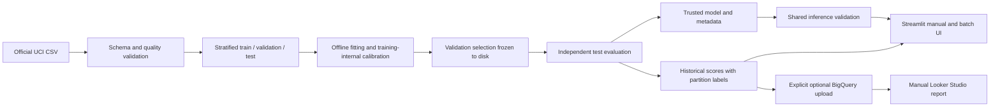

# Architecture

src/data_loader.py acquires and validates data. preprocessing.py builds estimator pipelines.
train.py owns experiment order; evaluate.py owns thresholds and metrics; inference.py owns
external input and model loading; ui.py owns cached local data and chart styling. app.py
routes four pages from views/. Unlike the brief's suggested pages/ directory, views/ avoids
Streamlit's legacy auto-discovery bypassing the entrypoint on cold direct-page requests.
cloud/ contains opt-in ADC-based setup, replacement upload and read-only analytics.

models/ contains a trusted serialized pipeline and manifest. artifacts/ contains split membership,
frozen selection, evaluation, calibration curves, feature importance, historical scores and test evidence.
artifacts/reference_reproduction/ is explicitly a separate reference experiment. data/raw/ retains
the unchanged official CSV. Absolute module-root path resolution avoids cwd-dependent data access.

The probability extension in src/probability_profile.py reconstructs an existing calibrated
candidate from training data and saved validation decisions. Its probability_model.joblib and
probability_metadata.json are the dashboard's default inference artifacts. Original selected_model
and metadata stay preserved. historical_probabilities.csv supplies the overview; the shared
sidebar policy changes threshold classification across overview, manual and batch inference.
The corresponding prepared BigQuery export now carries failure_probability and classification_policy.

Cloud Run hosts the same inference application; no retraining, data append, or cloud check runs at
startup. BigQuery uses one dedicated observations table combining original measurements, scores,
partition and model metadata, plus a type_summary view. Explicit upload uses WRITE_TRUNCATE
on that dedicated demo table, never append. Looker Studio is manually connected. Workbench calls
the same modules, preserving methodology. No Vertex model endpoint, Pub/Sub, GPU or always-on VM.

Streamlit resources/data are process-cached; restart after changing persisted artifacts.
Manual/batch inference is stateless. Uploaded input is not persisted or sent to BigQuery.
The application reads environment configuration and uses ADC/service identity only on explicit
cloud actions. No service-account key is bundled. The container uses a non-root user and a
health endpoint. Public access, authentication and IAM are chosen during the manual deployment.
